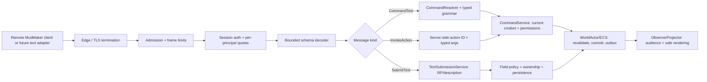

# 01 — End-to-End Internet Input Boundary

**DECIDED v1 pipeline; not an implemented server.** This is the single authority for trust boundaries and ordering. Reference [network policy](02-admission-limits-and-backpressure.md), [command grammar](04-command-parser-grammar.md) and [text](03-text-and-multiline.md) only when needed.

## Input message classes
- **Pre-auth:** protocol hello, login/refresh as explicitly allowed by the handshake state machine, bounded heartbeat. Never a game command or world query.
- **Authenticated gameplay:** `CommandText` (legacy/typing), `InvokeAction` (GUI/typed), `SubmitText` (RP message/character bio/profile), `ChooseCandidate` (server-issued ambiguity selection), `Heartbeat`.
- **Not player messages:** script source, compiled DLL, executable graph plans, project/theme editor commands, host config, dynamic hook name, event credit, reward success, NPC visibility flags, arbitrary ECS patch. Unexpected message kinds fail closed; no generic `inputfunc(name,args)` reflection dispatch from remote protocol.
- **Host editor only:** `CommandDefinition`/CommandSet creation and publisher; different local authority/transport path, not player gateway.

## Mandatory processing order
1. Edge enforces TLS, connection caps, handshake deadline, origin policy for browser clients, and limits decompression before allocating application objects.
2. Gateway enforces raw frame **byte** limit, max assembled message and per-connection byte-rate; rejects oversize before data buffering/JSON/Protobuf parsing. Bounded parser rejects bad UTF-8, unknown discriminators, excessive nesting/fields, duplicate field ambiguity, non-finite values and invalid IDs. Never fallback to eval.
3. SessionService derives world/account/character/role from authenticated session. Client-supplied world/actor ID is a **claimed routing hint** at most, never authentication. Revocation/expiry checked on actions; preauth cannot send world commands.
4. Gateway enforces per-IP, account, session, world and **action-class** token buckets and bounded work queues before expensive world scans or script worker calls. Central resource budget does not rely on freeform text blacklist.
5. `CommandText` routes through the explicit command grammar; `InvokeAction` calls the *same* resolved command semantics; `SubmitText` bypasses command parser **only** to enter a field-specific data policy. Neither path gains extra permissions.
6. Native `CommandService` resolves available command sets from authoritative actor/location/inventory/sessions and validates target visibility, lock rules, preconditions, cooldown and rate class. All client-supplied target refs are re-resolved in actor world with generation and visibility checks.
7. One authoritative ECS write validates requested effects against current state and commits atomically with idempotency/event log/outbox. No client or script directly modifies ledger/visibility.
8. Outbound messages are audience-filtered and encoded for the receiving rendering context. Logs are structured and sanitized; no raw secrets/large text dumps.

## Security invariants
- Every operation has **one** canonical action ID and permissions whether started by typed GUI button, typed console command, accessible keyboard, or future telnet adapter. **No split authorization** across input paths.
- Server **never** interprets `SubmitText.body` as command lines, URL, HTML, C# or arbitrary serialized object. User-entered characters resembling `/admin`, `@create`, XML, SQL or ANSI are text, never executable syntax.
- Resource cost is measured at multiple levels: bytes, number of decoded fields/nesting, Unicode scalar/grapheme count, line count, target candidate scan, command compute and downstream fanout.
- Errors show safe `INPUT_TOO_LONG`, `RATE_LIMITED`, `COMMAND_AMBIGUOUS`, `TARGET_NOT_VISIBLE`, `BAD_ARGUMENT`, `UNAVAILABLE`, etc. No internal stack/hidden NPC identity in player messages.
- Client-connected source and remote host are adversarial network peers. Hosting is distributed/self-hosted: MudMaker does **not** centrally host every world. Only host-owned local scripts run.

## Primary documentation used
- Evennia [cmdhandler](https://www.evennia.com/docs/latest/api/evennia.commands.cmdhandler.html), [inputfuncs](https://www.evennia.com/docs/latest/api/evennia.server.inputfuncs.html), [Command Sets](https://www.evennia.com/docs/latest/Components/Command-Sets.html).
- OWASP [WebSocket Security](https://cheatsheetseries.owasp.org/cheatsheets/WebSocket_Security_Cheat_Sheet.html), [Input Validation](https://cheatsheetseries.owasp.org/cheatsheets/Input_Validation_Cheat_Sheet.html).
