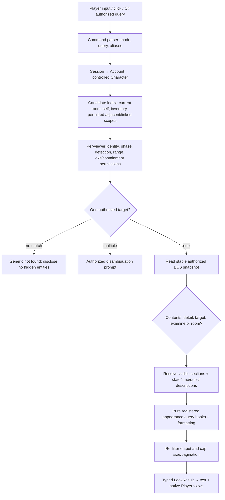

# LOOK, observation, inspection and appearance — binding contract

**Status:** binding product and authoring specification; runtime implementation not yet delivered. **Owner:** command parser + ECS perception/projection service; one canonical LOOK system shared by Player, Creator preview, accessible text commands, C# and visual graphs. Reuses [narration](narration-and-observers.md), [prompt/map](prompt-and-world-map.md), [spatial containment](../02-architecture/spatial-containment-transit.md), [inventory](inventory-and-containers.md) and [versioned scripting](scripting-v1/03-hook-registry.md).

## Why this design: Evennia research crosswalk

Evennia's default `CmdLook` supports `look`, `look <obj>` and its special `look *<account>` syntax; `l`/`ls` aliases, `here` as current location, `me`/`self` as the character. Its object sequence checks view access, invokes looker's `at_look(target)`, then target `return_appearance(looker)`, which assembles viewer-aware name, description, exits, characters, things, header and footer. These are separate override points. See [Evennia CmdLook](https://www.evennia.com/docs/latest/api/evennia.commands.default.general.html), [Objects and look pipeline](https://www.evennia.com/docs/latest/Components/Objects.html), [object API](https://www.evennia.com/docs/latest/api/evennia.objects.objects.html). Evennia's [Locks](https://www.evennia.com/docs/6.x/Components/Locks.html) distinguish `view` from `examine`: we adopt the *security distinction*, not its literal lock expression parser.

Evennia [Extended Room](https://www.evennia.com/docs/latest/api/evennia.contrib.grid.extended_room.extended_room.html) adds named details that need no database entity, seasonal/time/state-aware descriptions, fallback and contextual room states; [Extended Room guide](https://www.evennia.com/docs/2.x/Contribs/Contrib-Extended-Room.html) explains state, time slots, and echoes. Evennia's [Containers contribution](https://www.evennia.com/docs/latest/Contribs/Contrib-Containers.html) adds a specialized look for contents through a modified command set. [EvMenu](https://www.evennia.com/docs/latest/Components/EvMenu.html) may re-show menu text using LOOK and can execute LOOK when exiting. MudMaker supplies these as **one integrated command family**, not conflicting replacement command sets. These are source-derived observations; the exact MudMaker decisions below are our product contract.

## 1. Canonical commands, syntax and precedence

| User input (case-insensitive verbs) | Exact MudMaker operation | Defaults |
|---|---|---|
| `look`, `l`, `ls` | `LookMode.Location` | Current effective Location, including moving vessel room |
| `look here`, `look room` | `LookMode.Location` | `here` and `room` reserved for current Location |
| `look me`, `look self` | `LookMode.Target` | The controlled Character, not Account |
| `look <name>`, `look at <name>`, `l <name>` | `LookMode.Target` | Resolve one authorized visible object/character/exit or detail |
| `look in <container>`, `look inside <container>` | `LookMode.Contents` | Inspect accessible immediate contents, paginated |
| `look into <container>` | `LookMode.Contents` | Alias, not an extra engine |
| `look on <surface>`, `look under <thing>`, `look behind <thing>`, `look through <opening>` | `LookMode.DetailRelation` | Resolve creator-authored relation/sensory affordance; no automatic hidden-item reveal |
| `examine <target>`, `ex <target>` | `LookMode.Examine` | Detailed authorized information; distinct permission from ordinary `look` |
| `look at <detail>` | `LookMode.Detail` fallback | Named detail of visible target/current Location; never creates fake object |
| `look <exit>` | `LookMode.Target` | Describes exit itself; **does not traverse or reveal hidden destination** |
| `look out` | `LookMode.DetailRelation` when authored, else visible exit named `out` | Resolve exact visible target before relation alias |
| `look at "silver key"` | `LookMode.Target` | Quoted literal name, escaped text and Unicode normalized |
| `look 2.sword` | `LookMode.Target` | 1-based index among **authorized equal-name matches** in stable server sort |
| `look in chest/page 2` | `LookMode.Contents` | Page token supplied by server; arbitrary page numbers only when stable snapshot permits |
| `look *<account>` | **Not a built-in player LOOK syntax** | Account/profile lookup uses an independent authenticated command; prevents private identity conflation |

The parser consumes verb and optional preposition only when actually separated by whitespace; multiword names remain intact. Exact visible alias match precedes normalized exact name, then prefix matches; details are searched **after** real visible entities within target scope. `look at chest lid` first tries the full visible object name, then `chest` plus named detail `lid` if the base is visible. Partial matches never outrank exact matches. When multiple distinct authorized targets match, return an authorized numbered selection prompt; never enumerate hidden alternatives. No fuzzy matching by default, no guessable internal UUIDs in public text. Name selection is revision-checked at execution and times out; stale selection asks again.

The parser's ordinary command registry remains creator-configurable: custom worlds can disable/rebind aliases and add prepositions/verbs using typed `LookMode` registration, but cannot bypass security or mutate state by relabeling a command. Default `look in` is read-only; `open chest` remains a **separate authoritative mutation**. NPCs and AI may invoke host-authorized observation snapshots, not invented sensory knowledge.

## 2. ECS data model and projection API

- `AppearanceComponent`: versioned primary name/aliases, description blocks, optional header/footer and template asset references, formatting/localization keys.
- `LookDetail`: owner EntityRef, stable detail key, aliases, optional relation (at/in/on/under/behind/through), description variants, viewer/quest/sense visibility, reveal scope, version. Details are data attached to an entity or Location, **not** ECS entities or inventory items. Explicit promotion to an entity is required before interaction/pickup.
- `PerceptionProfile`: senses and optional range/illumination/occlusion detection policies bound to world/region/entity, typed creator-supplied rules; no mandatory sight-only MUD.
- `LookRequest`: authenticated WorldId, CharacterRef, mode, sanitized query or resolved target ref, expected client view revision (if supplied), explicit container/target scope, pagination token and request ID.
- `LookTarget`: `Entity`, `Exit`, `Detail` or `Location`; stable internal ID, visibility-qualified reference and source revision; no client-supplied authority.
- `AppearanceSnapshot`: viewer, requested mode and target, world/entity revisions, viewer-authorized name/description/header/footer; exits, visible characters, visible things, inspectable details and optional container entries; all sections typed and paginated as appropriate.
- `AppearanceSection`: stable section key, text and structured entries, sort/group rules, source revision, localization and presentation hints, explicit empty-state and visibility metadata.
- `LookResult`: `Success`, `NotFound`, `Ambiguous`, `NotVisible`, `NotReachable`, `Closed`, `AccessDenied`, `UnsupportedRelation`, `StaleSelection` or `RateLimited`; fail without revealing hidden matches.
- `LookTemplateAsset`: per-world default, per-region/location/entity/role overrides; section ordering/name/desc/exits/characters/things/header/footer, grouping, pluralization, typography and accessible text fallback. **Templates cannot select unauthorized data**.

Every object can have `AppearanceComponent` without acquiring the ability to hold items or be interacted with. A container has only one authoritative immediate parent per [inventory](inventory-and-containers.md), and LOOK IN queries its child index through the same custody/access service. Locations, moving train rooms, NPCs, mounted equipment, exits, bags and arbitrary entities all use the same presentation service.

## 3. Exact host-side read pipeline

Security applies **before search results are considered**, again before composition and before sending. A user cannot brute-force secret object names, undiscovered details, private inventories, locked exits, phased NPCs or container counts through LOOK, EXAMINE, autocomplete, numbering, API, error text or malformed selectors. At default policy, invisible targets produce the same generic no-match response as nonexistent targets; a distinct `NotVisible` code is available only to authorized diagnostics. A viewer's own visible inventory objects are searchable; someone else's inventory is not unless access grants it. LOOK is a pure query and **does not open locks, transfer items, reveal hidden quest flags or modify ECS**. Optional `OnLookObserved` gameplay triggers are *separate deferred intents after the observation*, capability-scoped, onceKey/deduped and never allowed to influence the current snapshot retroactively.

## 4. Appearance composition

Default room response section order: **Name → Description → Exits → Characters → Things → Footer**; header precedes Name if supplied. Empty sections are omitted. Exits are listed in configured exit order (otherwise stable name order); undiscovered exits aren't counted. Characters omit self and use viewer-aware names and optional states/poses. Things group equal-name stackable items only when the viewer is authorized to see their aggregated quantity; count cannot leak hidden objects. A closed/opaque container's contents are excluded even if it is carried. An open container displays permitted immediate contents in LOOK IN; recursively opening every nested container is forbidden, avoiding hidden/deep tree disclosure.

Object LOOK normally shows viewer-aware name, primary description, conditional details and optional authorized worn/held equipment summary; it does not automatically dump all fields or private item metadata. EXAMINE provides additional **creator-selected** details and is subject to an independent `examine` permission (default: same visible description, with no admin/debug attributes). Staff/Creator Inspector has separate authenticated diagnostics, never a public EXAMINE bypass.

The presentation service resolves variants **purely at read time** from committed room states, weather, world time/season, combat status, quest phase, character traits/roles, equipment and sensed illumination. Default fallback priority: owner/target exact matching condition → region matching condition → world default matching condition → target/base text → safe empty-description text. Among same-priority variants use highest explicit priority, then stable asset ID. Missing/invalid condition falls back, never crashes. No timer is required just to compute whether a season changes the room description; WorldClock is sampled. Dynamic echoes/sounds are separate scheduled narrated events, not automatically embedded private snapshots. Viewer-dependent aliases may differ from search keys without altering entity identity.

Formatting of rich text is constrained: supported markup is themed text spans, icons and approved links; no executable HTML, C# or external fetch; external clients receive escaped plain text/ANSI where protocol permits. Wrap to display capabilities, preserve screen-reader order and never use color alone to distinguish exits/status. Bounded response: 16 KiB of visible rendered text per LOOK by default, up to 50 listed entries per page, at most 16 detail relation levels and 16 nested containers checked by containment; overflow yields visible truncation and next-page token, not silent omission. Pagination tokens are server-signed, viewer+target+revision scoped and expire after 120 seconds. The host caps query frequency per actor to 10 per second burst and 3 sustained; these are initial configurable host policy defaults.

## 5. LOOK IN and relations: exact semantics

The default game supports reading a container only if `ContainerCapability` exists, viewer can perceive/reach the holder under game rules, and its visibility/lock/open-state policy grants the requested **read** action. `canLookInside` and `canTake` are separate grants. A sealed chest can be inspectable externally even when contents are hidden; a glass display can permit LOOK IN without allowing GET. If closed and opaque, return authored "You cannot see inside" without naming items; a transparent locked chest may disclose permitted visible contents without opening it. Access can be world/character/party/quest/faction/skill/custom graph policy. `look inside bag` reads immediate contents, not every nested bag. Looking at a disguised container need not expose that it is a container.

`look under/on/behind/through` consults the target's `LookDetail` relations or explicit spatial/sense query policies. The engine does **not** assume hidden objects become visible when a player asks under something. Discovering a secret requires creator-authored visibility/state transitions; those use a separate validated command or after-look event and re-evaluate later snapshots. The Player may see a link like "Inspect the latch" only when authorized by the same target-resolution service; clicking it issues the exact same LOOK request as typing the command. `LookDetail` may have conditionally available aliases and multiple description variants, but has no automatic physical mass, inventory, targeting or pickup semantics.

## 6. Creator authoring and first-class scripting

Creator selects any room/entity/exit → **Appearance & LOOK** inspector: Base description, advanced condition variants, target aliases, detail hotspots, relation keywords, visibility/sensory requirements, section layout, viewer-specific descriptions, empty-state text, localized text, and live preview "View as Character". **Basic mode** requires only one Description field; all else inherits safe defaults. **Advanced mode** edits conditions and existing typed graph nodes, no new programming DSL. Visual map can add LOOKable detail hotspots to room scenes without placing a physical ECS object; inventoried items remain separate real entities.

Graph nodes: On Look Requested (pure pre-query gate), Resolve Visible Target, Evaluate Perception, Select Description Variant, Get Appearance Section (authorized), Format Section, On Look Completed (post-read notification), On Detail Viewed, On Container Contents Viewed, and Request Authorized Reveal (subsequent validated state change). All route through the same typed worker and native projection API. **Pre-query nodes cannot grant hidden target access**; query hooks only alter already-authorized visible text or suppress their own visible sections.

Existing registered appearance hooks: `entity.appearance.resolve.query`, `entity.appearance.format.query`, `entity.appearance.name.query`, `entity.appearance.numbered_name.query`, `entity.appearance.header.query`, `entity.appearance.desc.query`, `entity.appearance.exits.query`, `entity.appearance.characters.query`, `entity.appearance.things.query`, `entity.appearance.footer.query`, and `entity.look.after`. All source-level registered hooks remain `runtimeImplemented: false` until audited runtime. This contract additionally defines `look.target.resolve.query`, `look.perception.query`, `look.detail.query`, `look.contents.query`, `look.examine.query`, `look.requested.after`, and `look.completed.after` with canonical DTOs in the scripting contracts. The exact C# types are `LookQueryEvent`, `LookObservedEvent`, `LookQueryResult` (read-only response, not mutable ECS) and bounded deferred `LookFollowUpEffect`; no arbitrary string-based script API.

## 7. Player presentation and accessibility

In the native Player Client, LOOK is both a typed command output and an interactive **room/object inspector** showing the identical authorized data. A reader can click/tap a visible character, exit, object, item or hotspot to look at it. Keyboard navigation and touch are first-class; the text command always works. Reconnect/stale-room snapshots invalidate target links and request fresh projection. Players can pin room description, hide/reorder sections, collapse exits or adjust font size; presentation preferences never modify the host's visibility or reveal additional fields. Generic third-party MUD connections simply render their server's LOOK text and may only offer navigational UX if structured room metadata is genuinely supplied. Never treat third-party text as trusted UI commands.

## 8. Test matrix and lifecycle dependencies

| ID | Test | Authoritative outcome |
|---|---|---|
| L01 | `look`, `l`, `look here` | Same authorized current-location description, exits, characters, things |
| L02 | `look me`, `look at sword`, aliases and quoted multiword names | Correct individual target, no account identity leak |
| L03 | Two swords with same name and `look 2.sword` | Deterministic selection from only visible candidates |
| L04 | Invisible NPC, hidden exit, private stash | No disclosure through exact name, ambiguity, count or stale token |
| L05 | `look in open bag`; nested bag | Only immediate authorized contents; pagination |
| L06 | Closed opaque/transparent locked chest | Correct separate look/access outcomes and no theft |
| L07 | Detail `look mural` without real object | Virtual detail resolves after visible entity search |
| L08 | `look under bed`, `look through window` | Authored relation or explicit unsupported response, no magical discovery |
| L09 | Winter/night/rain, quest phase and roomstate | Viewer-specific committed variant, deterministic fallback |
| L10 | Two players see different phased NPCs | Per-observer contents/exit lists and output isolation |
| L11 | Board moving train; LOOK inside Car B; dock and exit | Real containment and world scope, no station leak |
| L12 | Inspect equipment/merchant stock | No unauthorized inventory, price or private attributes |
| L13 | Custom C# appearance hook and graph equivalent | Same scoped DTO, no direct state changes/hidden text leak |
| L14 | Run malformed Unicode, long names, deep nested containers | Bounded query size/depth and stable structured error |
| L15 | 10,000 objects, duplicate names, 1M stored items | Indexed/paged lookup, no full-world scan |
| L16 | Reconnect, move while selection active, change permissions | Invalidated stale target; fresh snapshot, no leaked cached text |
| L17 | Screen reader, keyboard, mobile tap, generic telnet | Equivalent text and accessible ordering |
| L18 | Look-trigger quest observation | Separate deduped post-read event; never unauthorized free mutation |
| L19 | Dark room, blindness, stealth/senses and shared space | Configured perception profile filters before name resolution |
| L20 | Try `examine` hidden target or claim staff role | No permissions bypass or debug attribute disclosure |

**Sprint gates:** S05 entity/exit per-viewer target sets; S06 command parser and default room LOOK in real shell; S07 authenticated LOOK request and output; S08 Player LOOK inspector after first local playable; S09 Appearance & LOOK Creator inspector and live "view as" preview; S13 C#/graph/query parity; S18 malicious-name, hidden-target, scale, accessibility and reconnect audit. Each stage must provide a real live UI/command test—not a mocked screen.
