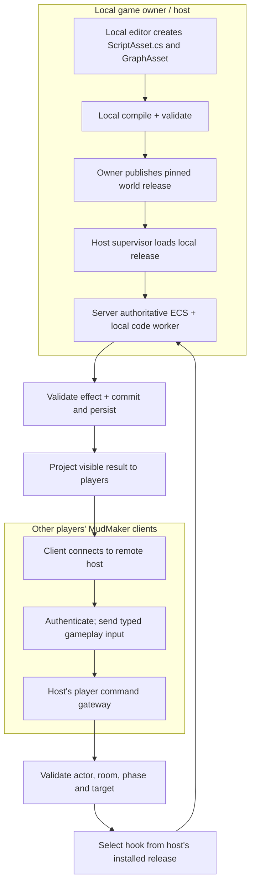

# 08 | Exact Local Host Script Loading and Player Input Contract

**DECIDED product boundary:** Every user can create their own game using MudMaker, run its hosted server locally or on their own provisioned host, and connect as a player to games other people host. The **game host** owns local source/project assets and explicit Publish/Host operations. Playing a game does not grant code authoring or scripting permissions over that game.

## Two independent paths

**Network protocol disallows:** script source, C# assemblies, GraphAsset executable plans, filesystem paths instructing the host what to load, compiler directives, reflection targets, remote publish/deploy commands, arbitrary hook IDs submitted as trusted commands. Scripts are chosen from host-side pinned bindings after validating game input; the player cannot request an otherwise inaccessible hook.

**Security:** Bound input length/types, authenticate actors, apply rate limits, validate request IDs, reject hidden NPC guesses, malformed choices and fake success facts. Isolate the host's own code worker for fault containment and resource budgets. Host-approved field overrides are legitimate; player-initiated actions can trigger them only through game-defined authenticated permissions and release-bound hooks.

**Testing:** Connect two ordinary MudMaker clients to a host; exercise gameplay triggers and prove no endpoint reads or accepts script bytes from clients. The same local release runs through GUI host and headless host. No centrally managed game service is presumed.
