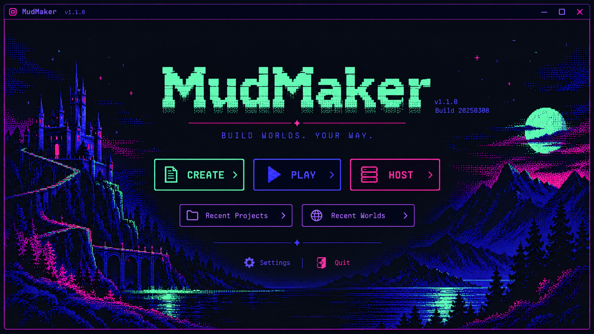

# 11 — Splash screen visual specification

**Owner direction:** retro minimalist launcher, visually related to all three mini-app workspaces. [Shared visual language](10-visual-language-and-shared-shell.md) and [canonical launch behavior](00-launch-and-workspace-navigation.md) apply; [Home control catalog](../../../contracts/ui/v1/home-controls.v1.json) owns registered UI elements.

## Visual composition
- Simple MudMaker wordmark near top with **actual installed semantic version/build** in small type.
- A modest pixel/ASCII-inspired landscape or line-art accent may give character; it must remain secondary, compact and decorative (never a status graphic).
- **Three equally prominent launch actions: Create, Play, Host.** They occupy the visual center in a compact aligned row (or vertical stack in narrow layouts), with no enclosing promotional cards or repeated action sidebar.
- **Create** opens Creator Editor; **Play** opens independent Player Client; **Host** opens Host Operations. None automatically creates a project, opens a remote connection or starts a server.
- Small **Recent Projects** and **Recent Worlds** links enter their respective lists. Do **not** turn these into giant list panels on the splash surface.
- Compact **Settings** and **Quit** actions at bottom edge. Appearance is under **Settings → Appearance**, not a visible preset selector here. Help may live in Settings or a small secondary location according to the registered controls.
- No news, tutorial deck, fake terminal activity, redundant navigation rail, marketing paragraphs, dummy engine indicators or unnecessary status panels.

## Conditional information
- Show exactly one unobtrusive host indication, **`Active World: {worldname}`**, when a real host is running in this app. If none, **show nothing** (not `No Active World`).
- Never show `Connected Worlds` on Splash: all client connections are closed before leaving Play.
- Startup validation/recovery errors show concise relevant notice and **Retry** only on failure, with accurate state. Normal ready state need not claim an engine is running.
- If application exit is requested during hosting, use the distinct stop-host-and-exit confirmation; cancel leaves application/host running.

## Information density and behavior
Wordmark, launch row, small recent links and footer should fit as a cohesive launcher without large gaps; use crisp type, thin dividers and restrained retro ornament. Accessible focus, text scale and touch target rules still apply. Do not render a project list as a duplicate set of Create buttons.

## Registry reconciliation
Keep existing `home.splash` IDs and actions where applicable. The owner-approved appearance relocation and removal of `Connected Worlds` should be reflected in the home catalog. Any extra Help/Settings navigation requires valid control metadata; don't invent commands for art alone.

## Approved visual reference (asset upload pending)

The owner approved the neon-pixel fantasy splash mockup. Place the PNG at **`docs/03-contracts/ui-ux/assets/mudmaker-neon-splash-reference.png`** on branch `working`. This file is an **aesthetic reference only**, not a literal requirement for example build IDs or sampled colors; use current ThemeManager tokens and the screen layout specification. Once uploaded, it will display here:

See [state-by-state wireframes](15-screen-wireframes-and-interaction-states.md) and [minimalist microcopy acceptance](16-microcopy-and-density-acceptance.md).
