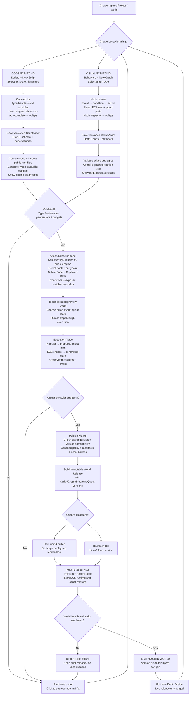

# 00 | From Authoring to a Live Hosted Game — Scripting Lifecycle Diagrams

**Status:** REQUIRED user journey; detailed sequence PROPOSED until native-engine/script-host ADRs approved. **Owner:** asset registry, graph/code compiler, binding manager, deployment supervisor, runtime hook dispatcher, ECS executor. **Read this ONE file** for whole-system lifecycle. Code-specific controls: [Code Scripting Index](code/INDEX.md). Graph-specific controls: [Visual Scripting Index](visual/INDEX.md). Cross-cutting contracts: [runtime](../../03-contracts/scripting-runtime-and-capabilities.md) and [permissions](../../06-quality/security-policy.md).

## Diagram A — Creation, testing, publishing and activation (both authoring paths)



**Important:** This is not a proposal to bounce between code and graph editors when one has an error: REPAIR returns the creator to the appropriate original asset. It depicts a common lifecycle and intentionally separates Save, Validate, Test, Publish and Host. The actual native library and C# runtime remain OPEN.

## Diagram B — What happens when a real player triggers a behavior

```mermaid
sequenceDiagram
    autonumber
    actor Player
    participant Client as Browser / Tauri Player Client
    participant Gateway as Session & Command Gateway
    participant World as Authoritative C++ ECS World
    participant Hooks as Hook / Binding Registry
    participant Runtime as Graph Runtime or Isolated Code Worker
    participant API as Typed ECS Capability Gateway
    participant Store as Persistence / Event Log
    participant View as Observer / Narration Projection
    actor Other as Nearby Player

    Player->>Client: Click Interact or type command
    Client->>Gateway: Action request with session + requestId
    Gateway->>World: Authenticate / authorize / resolve actor
    World->>World: Check location, target, locks and world revision
    World->>Hooks: Resolve event + bound handler + mode
    Hooks->>Runtime: Call version-pinned script/graph with safe snapshot + typed refs
    Runtime->>API: Query approved components or propose actions
    API-->>Runtime: Permission-filtered values and effect result
    Runtime-->>World: Typed HookResult / effect plan (not raw ECS writes)
    World->>World: Revalidate current state and permissions; atomic transition
    alt Valid and committed
        World->>Store: Persist coherent state + event cursor
        Store-->>World: Durable commit acknowledgement
        World->>View: Publish committed domain events
        View->>Client: Actor result + updated visible world
        View->>Other: Scoped message if eligible observer
    else Invalid, stale or script failure
        World-->>Gateway: Structured rejection; no partial success mutation
        Gateway-->>Client: Player-safe error
    end
```

**Execution notes:** The diagram is a logical contract; actual call ordering and atomicity of persistence/event publication are subject to transaction ADR. A Before/Replace hook may return Veto or DeferredQuestion instead of immediate effects. An After hook consumes already committed facts and schedules durable separately-authorized effects. The engine owns final state and narrations; workers never receive raw C++ pointers.

## Diagram C — Custom code exposed as a callable visual node

```mermaid
flowchart LR
  C["Code script with public typed method\nExpose to Graph + tooltip"] --> CP["Compile / validate signature"]
  CP --> REG["Versioned Node Type Registry\nInputs + outputs + capability contract"]
  REG --> PAL["Visual palette search\nCustom > script function"]
  PAL --> NODE["Creator adds typed node\nConnects event/data/action flow"]
  NODE --> GV["Graph validation\nVersion + ports + read/write permissions"]
  GV --> B["Published graph + script versions"]
  B --> R["Runtime graph invokes code host\nthrough same capability gateway"]
  R --> E["ECS command / transaction authority"]
```



**Signature changes:** Show every dependent graph and owner instance; keep old pinned versions functional or require a migration. No silent loss of node types.

## Concrete example — Ticket machine or quest event
1. Creator selects station cell → Ticket Machine → **Behaviors → Add Behavior**.
2. Chooses **Visual Graph**, or **New Code Script**. Graph: OnInteract → HasTicketStock? → Grant Ticket; code: typed OnInteract handler with exposed TicketsRemaining. Optional quest guard: "Only while Talk to Bob is Active."
3. Chooses **Before default / After / Replace / Both**, a failure policy, and fields shown in Inspector. Stores one versioned HookBinding.
4. **Validate** checks source/node types, asset references, actor scope and capability. **Test** chooses a sample player and world snapshot; trace shows whether a ticket was granted *in the isolated test world*.
5. **Publish** builds complete versioned release. Creator selects **Host World**, or operator uses the headless hosting command; both launch the exact same artifact.
6. A live player interacts. Gateway validates the player; the hook runs with permission-filtered snapshot; the ECS validates stock, quest state and recipient; commits grant and stock decrement once; only intended nearby users see creator-configured narration.
7. Creator modifies the script later. **Save Draft** does NOT alter live. A controlled republish/updater either safely activates a compatible version at a world boundary or requires planned restart/migration. Failed update preserves prior good release.

## Per-screen visibility and explicit controls
| Stage | Where creator is | Primary controls | Evidence of success |
|---|---|---|---|
| New | Asset Library / selected ECS object | New Script, New Graph, template picker | New draft ID + file/graph |
| Edit | Code / Node editor | Insert Reference, Add Variable, Add Node, Attach | Valid typed draft in project |
| Validate | Editor Problems pane | Validate, click diagnostic, view dependencies | Compile/type/permission result |
| Bind | ECS Inspector → Behaviors | Hook dropdown, handler, before/after/replace/both, conditions | Bound to exact target ID/version |
| Test | Isolated Playtest | Select actor/event/quest state, Run, Step, Trace | Observed ECS/test outcome, not cosmetic toast |
| Publish | Deployment wizard | Review changes, Confirm Publish | Immutable release ID/checksums |
| Host | Hosting dashboard or CLI | Host, Status, Stop, Rollback | World healthy + join address; real clients |
| Live inspect | Admin Script Inspector | Trace, version, fault, budget, per-world errors | Committed events and observer projection |

## Mandatory agent invariants
No UI-only script execution used as proof of live behavior; no workers changing ECS directly; no raw C++ handles in scripts; no scripts launched by desktop/browser player process; no unmanaged threads/timers per script; no undocumented hot reload; no false claim of public reachability from local server start; no non-atomic quest reward because of effect plan; no duplicate event narration on retries. Runtime language, IPC and worker topology must be locked via ADR before code.

## Acceptance
Both authoring paths independently pass this lifecycle, plus a graph calling a typed custom script node. Validate broken asset and forbidden API cases; verify test world vs hosted world separation, draft/live version separation, real player action plus bystander message, Linux headless parity, persistence across actual restart, and no duplicate reward/event on retry. See [scripting UX test matrix](05-scripting-ux-test-matrix.md).
