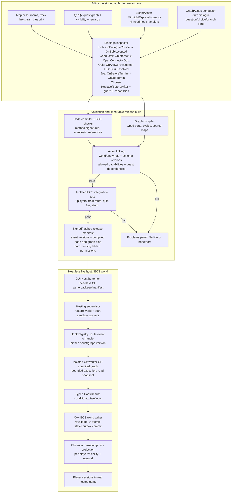

# Technical Case Study 01 — Midnight Express: Real Script → Live Multiplayer ECS

**Status:** binding worked acceptance scenario with illustrative (noncompiled) examples; runtime not implemented. **Goal:** engineering-level worked example with versioned source-contract data structures, script entrypoints, host interactions, authoritative ECS commit, event/outbox handling, and negative tests. **Stack candidate only:** C++ ECS engine + isolated C# code worker + typed graph compiler. Read **this file** for a complete vertical slice. Consult general files only to implement specific parts: [Code](code/INDEX.md), [Visual](visual/INDEX.md), [Runtime ABI](../../03-contracts/scripting-runtime-and-capabilities.md), [Quest Hooks](../quests/09-custom-scripts-and-event-hooks.md), [Moving Locations](../../02-architecture/spatial-containment-transit.md), [Narration](../../03-contracts/narration-and-observers.md).

> **Not source code.** The C# and C++ snippets below are typed pseudocode. Names such as `Effects`, `MudHook`, `CommitAtomically`, `WorldActor` and `EntityRef` are illustrative proposed interfaces, not shipped SDK classes or final APIs. Exact engine technology, script language, ABI, database, event delivery guarantees, and concurrency choices require ADR approval. The intent is precise behavioral and ownership semantics rather than pretending code compiles today.

## 1. Scenario: creator-authored Midnight Express quest chain

**Actors:** Bob (Northgate station NPC), Conductor (Car A NPC), Joe (Harbor NPC); players Alice and Pat; Midnight Express train with Car A and Car B; a storm world system; two stations and directed track route.

**Quest graph:** `TalkToBob` (Q1) Active → Bob's accepted dialogue choice → Q1 Completed + `FindJoe` (Q2) Active + StormEvent StartRequested/Active. Q2 has ordered objectives `BoardMidnightExpress` → `PassConductorQuiz` → `TalkToJoe`. Joe's first quest-specific conversation credits `TalkToJoe` from a server-committed dialogue choice. A distinct subsequent **Confirm Turn-In** command then verifies all objectives are satisfied, completes Q2, requests stopping StormEvent, grants the guaranteed rail pass, and conditionally rolls an additional reward **only if the player character's normalized display name starts with A**.

**World constraints:** The train follows tracks from Northgate to Harbor; its child carriage Locations are stable entities. Internal exits function while it moves. Boarding/disembarking are dynamic dock-conditional exits. Joe's one persistent shared-world entity is projected to observers only while Q2 is active or under a creator-configured post-completion rule. Pat can stand beside Alice in Harbor without seeing Joe. Room observer narration is event-derived, not printed directly by script.

**Player-facing observable output** might include:
- At Harbor when train arrives from north: “A train appears from the north.”
- In Car B as Alice arrives from Car A: “Alice enters from Car A.”
- At Harbor when Alice leaves train: “Alice departs a train.”
- Alice completes Joe dialogue: quest completion / storm clearing / normal and possible bonus reward messages. Pat sees only content allowed by location, quest phase and narration configuration.

## 2. Runtime components and data ownership

| Runtime object / asset | Conceptual schema and ownership | Important invariant |
|---|---|---|
| `WorldInstance` | worldId, releaseId, ECS registry, scheduler, command queue, event sequence, persistent cursor | One authoritative writer/transaction owner |
| `EntityRef` | worldId, entityId, generation, kind, optional read version | Opaque handle; no native pointer to C# |
| `SpatialParent` | child entityId → one parent Location/Container | Acyclic; player keeps Car A parent while train moves |
| `TrainMotion` / `RouteFollower` | train entity, track edge, progress, docking/door state | Track movement doesn't rewrite occupant containment |
| `DynamicExit` | source Location, destination resolver, lock predicates | Boarding permitted only on valid Docked snapshot |
| `QuestProgress` | character ID, questId/version, attemptId, state, objective IDs/flags, cursor | Per-character durable owner, no NPC-local duplicated truth |
| `PhaseRule` | Joe entity + condition `QuestIs(Q2, Active, actor)` | Filtering applies to look, search, target, interact and event projections |
| `DialogueSession` | player/target, graph/version, node/choices, server expiry/revision | Never global Bob/Conductor dialogue cursor |
| `QuizSession` | actor, instance, questionSet/version, shuffled option IDs, attempt/retry count, answer status | Server keeps correct answer; client receives only options |
| `HookBinding` | target asset, hook point, mode, script/graph hash, condition, capabilities, priority | Editor and server bind one versioned handler |
| `WorldEventInstance` | storm asset, world/region scope, lifecycle, cleanup/schedule, event key | Start/stop is durable, idempotent; not a free-floating timer |
| `RewardGrant` | attemptId, rewardPlan, onceKey, RNG context, claimed results | One grant per intended attempt/period despite retries |
| `CommittedDomainEvent` | eventId, sequence, causation, actor/source/destination, typed data | Facts recorded once, narration projected afterward |
| `OutboxRecord` | eventId, payload, delivery cursor, retry/status | Publication recovers after crash; clients dedupe eventId |

The ECS can store data-oriented component tables and auxiliary indexes; the schema names above are illustrative, not a proposal to allocate a heavyweight C++ object per row.

## 3. Exact creator authoring / binding pipeline



**Compile/load boundary:** `ScriptAsset` source + `GraphAsset` layout become *versioned compiled executable behavior*; `HookBinding` points at handler+asset versions, not mutable source text. **Host boundary:** Tauri, desktop and browser are authoring/player clients; the authoritative engine + workers run on the server. **Live versioning:** saving a new draft does not mutate the host; publish/reload is a separately validated controlled operation.

## 4. Illustrative C#-style pseudocode: four behavior examples

```csharp
// C#-STYLE PSEUDOCODE ONLY: exact SDK/API and binding names not approved.
// Handler executes in isolated script host, receives safe snapshots,
// and RETURNS actions. It never receives ECS pointers or DB access.

[MudScript("midnight-express", Version = "1")]
public sealed class MidnightExpressHooks
{
    [MudHook("Bob.OnDialogueChoice")]
    public HookResult OnBobAccepted(HookContext ctx, DialogueChoiceEvent e)
    {
        // The command gateway already authenticated and resolved the actor.
        // This guard is checked AGAIN by C++ immediately before commit.
        if (e.ChoiceId != Choices.AcceptRailJob) return HookResult.ContinueDefault();
        if (!ctx.Quests.IsActive(ctx.Actor, Quests.TalkToBob))
            return HookResult.ContinueDefault(); // generic dialogue configured elsewhere

        return HookResult.ReplaceDefault(
            Effects.CompleteQuest(ctx.Actor, Quests.TalkToBob, e.EventId),
            Effects.StartQuest(ctx.Actor, Quests.FindJoe), // explicit auto-accept
            Effects.RequestStartWorldEvent(WorldEvents.HarborStorm,
                                           scope: Scopes.HarborRegion),
            Effects.Emit(Events.RailJobAccepted, actor: ctx.Actor)
        );
    }

    [MudHook("Conductor.OnInteract")]
    public HookResult OpenConductorQuiz(HookContext ctx, InteractEvent e)
    {
        if (!ctx.Quests.IsActive(ctx.Actor, Quests.FindJoe))
            return HookResult.ContinueDefault();

        // Reads from immutable snapshot, never from client-supplied train status.
        if (!ctx.Trains.IsAboard(ctx.Actor, Assets.MidnightExpress) ||
            !ctx.Trains.IsInTransit(Assets.MidnightExpress))
            return HookResult.Reject(Errors.ChallengeRequiresTravel);

        return HookResult.ReplaceDefault(
            Effects.OpenQuiz(
                actor: ctx.Actor,
                npc: ctx.Target,
                questionSet: Questions.ConductorSignals,
                completionHook: "MidnightExpressHooks.OnQuizResolved",
                attemptScope: ctx.Quests.Attempt(ctx.Actor, Quests.FindJoe),
                idempotencyKey: Keys.For(ctx.InvocationId, "open-quiz"))
        );
    }

    [MudHook("Conductor.OnAnswerEvaluated")]
    public HookResult OnQuizResolved(HookContext ctx, QuizEvaluatedEvent e)
    {
        // The CLIENT submitted an opaque choice ID; the SERVER evaluated
        // correctness against private answer key before emitting this fact.
        if (!ctx.Quizzes.IsOwnedBy(e.QuizSession, ctx.Actor) ||
            !ctx.Quests.IsActive(ctx.Actor, Quests.FindJoe))
            return HookResult.Reject(Errors.InvalidQuizState);

        if (!e.IsCorrect)
            return HookResult.ReplaceDefault(
                Effects.RecordQuizAttempt(e.QuizSession, correct: false),
                Effects.Dialogue(Assets.IncorrectAnswerDialogue));

        return HookResult.ReplaceDefault(
            Effects.RecordQuizAttempt(e.QuizSession, correct: true),
            Effects.CreditObjective(ctx.Actor, Quests.FindJoe,
                                    Objectives.PassConductorQuiz, e.EventId),
            Effects.Dialogue(Assets.CorrectAnswerDialogue),
            Effects.Emit(Events.ConductorChallengePassed, ctx.Actor));
    }

    [MudHook("Joe.OnBeforeTurnIn")]
    public HookResult OnJoeTurnIn(HookContext ctx, TurnInEvent e)
    {
        var attempt = ctx.Quests.Attempt(ctx.Actor, Quests.FindJoe);
        if (!attempt.IsActive || !attempt.AllRequiredObjectivesMet)
            return HookResult.Reject(Errors.QuestNotReady);

        // Replace normal turn-in deliberately, while EXPRESSLY including
        // the standard reward plan. No hidden automatic default reward.
        var effects = new EffectPlan()
            .Add(Effects.CompleteQuest(ctx.Actor, Quests.FindJoe, e.EventId))
            .Add(Effects.RequestStopWorldEvent(WorldEvents.HarborStorm,
                                               scope: Scopes.HarborRegion))
            .Add(Effects.GrantRewardPlan(
                ctx.Actor, Rewards.RailPass, onceKey: attempt.RewardKey("base")));

        // Creator configured character DISPLAY name, not login/account name.
        // Normalization/case rules are explicit, shared with graph conditions.
        if (ctx.Text.StartsWithNormalized(ctx.Actor.DisplayName, "A"))
        {
            // RNG is SERVER-owned and scoped to the attempt + reward key.
            // Replaying the request cannot reroll.
            effects.Add(Effects.RollRewardTable(
                ctx.Actor, Rewards.MidnightMysteryTable,
                onceKey: attempt.RewardKey("name-bonus")));
        }

        return HookResult.ReplaceDefault(effects);
    }
}
```

### What the script DOES NOT do
- No `entity->components` raw pointer, `malloc/free`, `new Train()`, `database.ExecuteSql`, `File.ReadAllText`, `Thread.Sleep`, private `Network.Broadcast` or `player.QuestCompleted = true`.
- No client-reported correct answer. Client only chooses a server-issued opaque choice ID.
- No direct script-side `Random.Shared` controlling claimable loot. The engine selects/persists reward table result with stable idempotency key.
- No free-floating C# task responsible for making a storm stop. The world-system manager owns its durable lifecycle.
- No direct player-to-player message broadcast. The authoritative events produce per-observer projections.
- No guarantee that asynchronous storm cleanup is atomically finished with the quest completion; **request to stop** commits and cleanup proceeds durably, with visible pending/failed status and recovery policy.

### Script-to-graph equivalence
Conductor quiz may be authored as typed graph:
```text
[Event: NPC.OnInteract]
     |
     v
[Condition: Quest FindJoe Active] --false--> [Default NPC Conversation]
     |true
     v
[Condition: Aboard Midnight Express AND InTransit]
     |true                                 |false
     v                                     v
[Open Quiz: ConductorSignals]        [Show "Wait until underway"]
     |
     v    (later, from separate server-authoritative AnswerEvaluated event)
[Event: Quiz AnswerEvaluated]
     |
[Condition: Result Correct?] --false--> [Wrong answer dialogue]
     |true
     v
[Credit Objective: PassConductorQuiz]
     |
     v
[Emit: ConductorChallengePassed]
```
The graph creates the same `HookResult/EffectPlan` as C# code. It does not call script-managed quest state or bypass the QuizService.

## 5. Proposed C++-style world actor / transaction pseudocode

```cpp
// C++-STYLE PSEUDOCODE, NOT AN IMPLEMENTATION.
// Network I/O and sandbox calls are asynchronous, never block ECS world writer.

void WorldActor::OnAction(ActionRequest request) {
    const auto session = sessions.requireAuthenticated(request.sessionId);
    const auto actor = auth.requireOwnedActor(session, request.actorRef);
    auto context = world.snapshotFor(actor, request.targetRef);
    commands.validateAgainstSnapshot(request, context);  // phase, target, exit

    const auto binding = hookRegistry.resolve(
        releaseId, request.actionType, request.targetRef, context);
    if (!binding) { enqueueBuiltinAction(request); return; }

    PendingInvocation pending {
        .requestId = request.requestId,
        .invocationId = idempotency.uniqueHookId(request),
        .worldId = world.id,
        .snapshotRevision = context.revision,
        .readVersions = context.relevantEntityVersions(),
        .bindingVersion = binding.version
    };
    pendingStore.record(pending);               // recoverable; not a world mutation
    workers.submitAsync(binding, context.safeReadDTO(), pending.invocationId,
        [worldQueue = queue](WorkerResult result) {
            worldQueue.enqueue(Command::CompleteInvocation(result));
        });                                     // no blocked world tick
}

void WorldActor::OnWorkerResult(WorkerResult result) {
    auto pending = pendingStore.require(result.invocationId);
    if (idempotency.alreadyCommitted(pending.requestId))
        return publishCachedOutcome(pending.requestId);
    if (result.isFailure())
        return failAndTrace(pending, result.safeError()); // no success effects

    auto plan = typedEffects.decodeAndValidate(result.effectPlan);
    auto tx = store.beginWorldTransaction(world.id);

    // Reread/revalidate because other actions may have committed
    // while script worker was running. Check affected entity versions,
    // current quest attempt, actor/target phase, dock, item ownership,
    // capability manifest, budget and all effect preconditions.
    if (!commands.revalidate(pending, plan, world, auth)) {
        tx.rollback();
        return rejectOrRetryByPolicy(pending, Errors::StaleWorldState);
    }

    // Atomic proposed boundary: state + quest + reward + scheduled
    // world-event start/stop intent + durable outbox / idempotency record.
    // DB or journaling strategy is OPEN and must guarantee recoverability.
    const auto changes = world.stageValidatedEffects(plan);
    tx.write(changes.components, changes.questState, changes.rewardLedger);
    tx.write(changes.worldEventIntents, changes.durableSchedulers);
    tx.write(changes.committedEvents, changes.outboxRows);
    tx.write(idempotency.recordFor(pending.requestId));
    tx.commitOrThrow();

    world.applyCommitted(changes);                // canonical state epoch
    projectionQueue.enqueue(changes.committedEvents); // after commit only
    pendingStore.finish(pending.invocationId);
}
```

**Critical design caveat:** The precise `store.beginWorldTransaction` ordering, in-memory publish barrier and restart recovery protocol depend on the approved persistence ADR. A correct implementation must not make the database durable while keeping an inconsistent live ECS state if the process crashes between commits. Options include transactional outbox plus recoverable state journal/snapshot epochs. The pseudocode states the required atomic/recovery boundary, not that a particular database already provides it.


## 5A. Typed wire messages between native engine and isolated C# worker

**The host-to-script boundary is not a C++ function pointer or a C# direct registry read.** It is a versioned message protocol. Binary serialization format (e.g. protobuf or FlatBuffers) is an ADR, but the logical schema and validation requirements are concrete:

```text
// Proposed IDL pseudocode; names, wire numbers and serialization undecided.
type EntityRef { worldId: WorldId; entityId: EntityId; generation: u64; }
type VersionedAssetRef { id: AssetId; revision: AssetVersion; }

message HookInvoke {
  protocolVersion: u32;
  invocationId: UUID;             // unique durable invocation ID
  requestId: UUID;                // client command idempotency key
  worldId: WorldId;
  releaseId: ReleaseHash;
  hookBinding: VersionedAssetRef;
  handlerId: HandlerId;           // validated against compiled manifest
  actor: EntityRef; target?: EntityRef;
  committedWorldRevision: u64;   // snapshot read epoch
  observedEntityVersions: map<EntityRef, u64>;
  event: TypedEvent { typeId, version, payload };
  authorizedReadSnapshot: TypedComponentView[];  // filtered fields
  allowedCapabilities: CapabilityId[];           // intersect manifest+actor
  deadline: MonotonicDeadline;
  traceId: UUID;
}

enum HookOutcome { ContinueDefault, Reject, DeferChoice, EffectPlan }
message HookReply {
  invocationId: UUID;
  hookBindingRevision: AssetVersion;
  outcome: HookOutcome;
  error?: SafeErrorCode;
  effects: ProposedEffect[];     // tagged union, never arbitrary raw opcode
  diagnosticTrace: TraceRef;     // filtered; not player-facing
}

union ProposedEffect {
  CompleteQuest { attemptId, evidenceEventId }
  StartQuest { actorRef, questDefinition }
  OpenQuiz { actorRef, questionSetRef, attemptId, onceKey }
  CreditObjective { attemptId, objectiveId, evidenceEventId }
  RequestStartWorldEvent { eventDefRef, scope, onceKey }
  RequestStopWorldEvent { eventInstanceRef, onceKey }
  GrantRewardPlan { recipientRef, planRef, onceKey }
  RollRewardTable { recipientRef, tableRef, onceKey }
  EmitDomainEvent { typeId, version, typedPayload }
  ShowDialogue { actorRef, dialogueAssetRef }
}
```

**Wire validation and failure behavior:**
- Gateway creates an authenticated `requestId`; the server creates and persists `invocationId`. User content cannot supply or forge actor/target/permissions or arbitrary effect types.
- World performs schema and version checks on every field and reference. Payload lengths, recursion, collection sizes and worker execution cost are bounded by approved configuration. Unknown protocol/asset versions fail closed.
- The script worker receives **filtered value snapshots**, not arbitrary registry query callbacks or C++ addresses. If a script needs extra data, it requests a **typed capability-limited read** and the engine may return a new versioned snapshot. Such round trips must be bounded, measured and not block the world writer.
- The world actor **revalidates affected reads and preconditions after the worker reply**, because entity position, NPC visibility, quest progress, train docking or ownership may have changed while a script was executing.
- `ProposedEffect` messages are instructions to validate, **not** a signed permission to modify ECS. Capability and actor/target authorization is recomputed by the authoritative server before commit.
- For `OpenQuiz`, the worker returns a trusted `questionSetRef`; the Quest/Dialogue service creates a durable session, randomizes option order under server RNG policy and stores correct-answer data privately. The client receives option display text + opaque IDs, **never** the answer key.
- For `RollRewardTable`, the engine chooses and records the result under a stable onceKey/seed; no script- or client-controlled reroll.
- Timeouts, worker crashes and stale revisions produce structured failures. Retry strategy must be idempotent and may re-invoke the handler only under explicit policy; fail-closed is required for state-mutating hooks.

### Performance rationale
A native world actor awaiting an out-of-process C# response synchronously on its update thread would stall the simulation. The proposed dispatcher stores a pending invocation, releases the writer, runs sandbox work asynchronously, then enqueues an effect-plan completion. Depending on script-call frequency, batching and compiled native graph execution may be preferable to one IPC roundtrip per entity. Benchmarks must measure representative hook throughput and p95/p99 tail latency before ABI/worker topology approval.

## 6. Live sequence: two-player interaction and exactly-once reward

```mermaid
sequenceDiagram
  autonumber
  actor Alice
  participant UI as Player Client
  participant GW as Auth + Command Gateway
  participant WA as C++ World Actor
  participant PH as Phase / Access
  participant HR as Hook Registry
  participant CS as Isolated C# Worker
  participant TX as State Store + Outbox
  participant WS as World-Event Scheduler
  participant NP as Narration / Interest Projection
  actor Pat

  Alice->>UI: Talk to Joe at Harbor
  UI->>GW: TurnIn(target=JoeRef, requestId=R42)
  GW->>WA: Authenticated actor/action
  WA->>PH: Is Joe visible, reachable, interactable to Alice?
  PH-->>WA: Yes, Q2 active + required objectives complete
  WA->>HR: Resolve Joe.OnBeforeTurnIn / release hash
  HR-->>WA: ReplaceDefault -> MidnightExpressHooks.OnJoeTurnIn
  WA->>CS: HookInvocation snapshot + safe refs + budgets
  CS->>CS: Read quest state and normalized display name
  CS-->>WA: EffectPlan(CompleteQ2, StopStorm, RailPass, BonusRoll)
  WA->>WA: Revalidate phase, quest, idempotency, capabilities
  WA->>TX: Atomic write quest state + reward ledger + stop intent + events + outbox
  TX-->>WA: Commit version V+1 or fail
  WA->>WS: Committed StopStorm intent (durable)
  WS->>WS: Cleanup weather/spawner state via ECS commands
  WA->>NP: Committed QuestCompleted / RewardGranted events
  NP->>UI: Alice sees quest success + eligible rewards
  NP-->>Pat: Only authorized public weather/room narration
  Note over NP,Pat: Pat does not see Joe or private quest/reward data
  UI->>GW: Retry same requestId R42 after reconnect
  GW->>WA: Duplicate request
  WA-->>UI: Return cached committed result; no second reward or storm stop
```

**Separate train movement events:** `TrainDocked(Harbor, fromNorth)` yields a platform narration event before the actor's later `Disembarked` event. `ActorMoved(CarA,CarB)` delivers source and destination room variants while the train remains InTransit. They do not need to call the Joe script.

## 7. Explicit state transition / sample test matrix

| Scenario | Before | Command/fact | After authoritative commit | Audience/output |
|---|---|---|---|---|
| Bob generic | Q1 absent | Interact Bob | No quest change | Bob generic line to actor only unless configured |
| Bob quest | Q1 active; Q2 absent; storm inactive | Accept dialogue choice | Q1 complete; Q2 active; Storm start intent recorded | Actor quest update; scoped storm announcement |
| Train moving | Alice in Car A, train InTransit | Move internal exit | Alice parent=Car B; train progress unaffected | Car A sees leave; Car B sees enter; station sees nothing |
| Quiz wrong | Q2 active, on train | Select wrong option | Attempt recorded; no objective credit | Only player sees feedback unless configured |
| Quiz correct | Q2 active, on train | Select server-validated correct option | Quiz credited once | Player response and eligible room narration |
| Joe hidden | Pat same Harbor cell, no Q2 | Look / Interact JoeRef | No access and no leaked ID | Pat never receives Joe presence or dialogue |
| Joe turn-in | Alice Q2 requirements met; storm active | TurnIn Joe request R42 | Q2 complete, stop intent, base reward, conditional bonus roll ledger | Alice gets rewards; Pat only allowed public world effects |
| Duplicate | Q2 complete; R42 already committed | Retry R42 | No second mutation or RNG roll | Cached response or safe deduplicated acknowledgement |
| Worker timeout | Q2 active; no commit | Script hangs | No committed success, typed failure and trace | Actor-safe error; other worlds unaffected |
| Crash after commit | State + outbox persisted, delivery pending | Restart | Same state/award with outbox replay and client dedupe | No repeated visible reward after event-id dedupe |

## 8. Minimum technical acceptance checklist

1. Authoring: code script, conductor quiz graph and 4 exact bindings serialize with stable IDs, versions and capability manifests. All source paths and node ports resolve.
2. Compilation: intentionally wrong C# signature and disconnected graph fail with file:line / node:port diagnostics. Corrected versions compile. Published release pins immutable hashes.
3. World invariants: station/track/door, train cars, passengers, inventory, NPCs, phases and world event all exist as validated ECS definitions, not mock output.
4. Real network: Alice and Pat connect to a headless world. Both see appropriate train narration but only Alice can target quest-phased Joe.
5. Quiz: correct answer not in client payload; forged choice rejected; retry/reconnect does not double-credit; question session survives per declared persistence policy.
6. World event: starting/stopping storm is durable; crash during stop resumes cleanup or reports recoverable failure. No orphan spawner or in-memory-only global timer.
7. Rewards: exactly one base grant and at most one optional table roll per authorized attempt; name predicate evaluated from server-controlled character data; RNG result persists across retries.
8. Memory/security: worker cannot access raw native pointers, foreign world, filesystem/process/network or unapproved C++ function; expired handles cannot crash engine; killed worker doesn't corrupt world.
9. Latency: measure event-to-hook-to-commit p50/p95/p99 and worker/IPC overhead; no unbounded synchronous worker wait in tick loop. Targets require approved ADR.
10. Deployment: Save Draft != Validate != Test != Publish != Live. New drafts do not change running gameplay; bad deploy retains prior version. GUI/CLI start exactly the same release.
11. Documentation: test results include actual commands, state snapshots/queries, events, error codes and independently verifiable assertions. A displayed message by itself never counts as feature success.

## 9. Open decisions before implementation

The exact C++ ECS framework, scheduling and transaction model; code language/runtime and worker isolation; effect-plan serialization; version migrations; snapshot/event ordering and script retry; quiz persistence and random-number seeding; producer/consumer idempotency; optional after-hook atomicity; and public-host privilege model. These are identified in [OPEN_DECISIONS](../../02-architecture/architecture-decisions.md). Implementers must not silently resolve them merely because pseudocode shows one possible interface.

## Current executable-shape contracts supersede the earlier illustrative method names
This page is an illustrative **scenario and architecture walkthrough**, not the normative creator SDK. Use [v1 exact method signatures, hook IDs, typed references, state overrides and wire protocol](../../03-contracts/scripting-v1/INDEX.md), [real C# interface declarations](../../../contracts/scripting/v1/MudMaker.Scripting.Abstractions/Contracts.cs) and [host-authored Midnight Express C# source example](../../../examples/scripting/MidnightExpressHooks.cs). **Only locally authored host-published scripts execute.** External player clients send authenticated gameplay input; they do not send scripts. Do not implement methods named in this earlier pseudocode when they differ from the v1 SDK.
