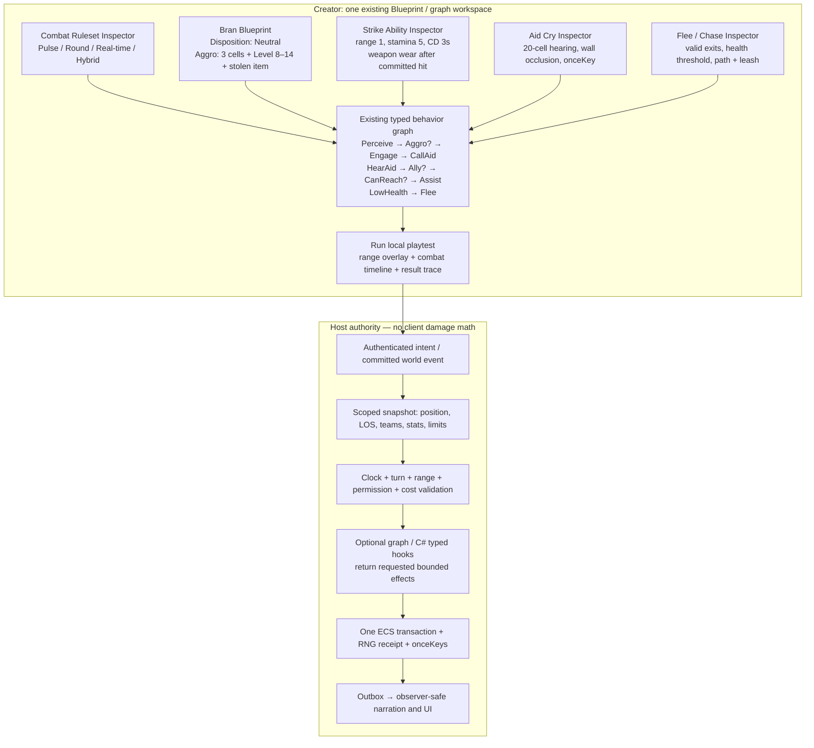
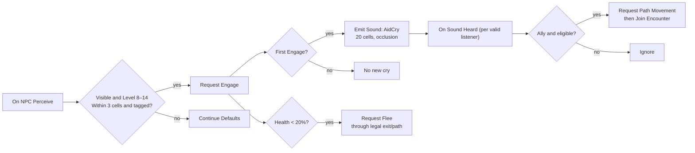

# Technical Case Study 02 — The Tollbridge Ambush: configurable combat end to end

**Status:** binding combat contract with an illustrative C# behavior sketch. Hook IDs are now in the versioned registry; runtime implementation remains pending. The convenience `CombatEffects` methods and event-specific aliases in the sketch are explanatory rather than actual SDK signatures. Follow [Midnight Express technical case study](07-midnight-express-technical-case-study.md) for the same engine/graph/worker/commit discipline, and [combat contract](../../03-contracts/combat-and-encounters.md) for supported modes. Real SDK identity and effect surfaces are defined in `contracts/scripting/v1`; this example does not change them by implication.

## 1. Scenario and reusable rulesets

A creator builds an eastern tollbridge encounter on a 2D cell grid with adjacent room passages. The player **Iris** (level 12 by this game's optional Level stat) crosses a tollbridge guarded by **Bran** (level 10), with **Tess**, an allied ranger, 14 cells away behind trees. A third guard **Orin** is 22 cells away and should not hear Bran's ordinary aid cry if the sound radius is 20 cells. A locked gate, a low stone wall and a bridge edge provide actual path/LOS constraints.

**Bran's disposition:** neutral until attacked, toll refused, or a character with level between 8 and 14 approaches within 3 cells while carrying a marked stolen item. On first engagement he calls for help *once per encounter*, producing a committed audible signal with 20-cell radius, subject to occlusion and hearing rules. Tess may pursue through open cells if eligible; Orin hears nothing. Bran can disengage and flee if below 20% health. Iris can flee through the unlocked western exit, but cannot flee through the locked east gate. None of this depends on a hardcoded Level attribute; this game's preset adds it.

This fixture must run under **three different CombatRulesets using the same entities and ability definitions**:

| Ruleset | Turn/clock | Observable behavior |
|---|---|---|
| `PulseMUD` | Host pulse every 2 s; autoattack plus manual abilities | Attack/pursue/aid resolves on pulses; manual command can replace next queued autoattack |
| `RoundDuel` | Initiative rounds with one action per actor and movement budget | Turn prompt; attacks/calls/flee consume configured actions; Tess joins next eligible phase |
| `RealTimeCast` | Independent cast 0.8 s; 3 s cooldown; interruptible | Authorized casts resolve after host deadline; a stun interrupts; escaping via world exit remains real-time |

An optional `HybridCharge` preset replaces round order with charge meters and timed declaration windows; it uses the same service and is a fourth acceptance mode. For non-grid worlds, the creator changes the distance adapter to rooms/hops or near/mid/far bands; the event and AI behavior graph remains identical.

### Example Creator configuration (illustrative YAML)

```yaml
combatRuleset:
  id: tollbridge
  mode: pulse
  timeline: { periodMs: 2000, disconnect: retain-until-timeout }
  rangeAdapter: grid-cell-path
  hearing: { shape: weighted-radius, defaultRadiusCells: 20, wallsOcclude: true }
  stats:
    Level: { type: integer, min: 0, max: 999, optional: true }
    Health: { type: resource, min: 0, max: derived:MaxHealth }
    Stamina: { type: resource, min: 0, max: 100 }
  victory: { onZeroHealth: unconscious, lootMode: none }
  fleeing: { contest: speed-vs-pursuit, lockedExitsDeny: true }
  gear: { durabilityEnabled: true, wearOnCommittedHit: 1 }
npc:
  id: Bran
  disposition: neutral
  aggroRule: "(distance <= 3 && level >= 8 && level <= 14 && carries('MarkedLoot')) || attacked"
  homeLeashCells: 12
  aid: { enabled: true, cooldownSeconds: 90, radiusCells: 20, oncePerEncounter: true }
  flee: { belowHealthRatio: 0.2, toward: nearest-valid-safe-cell }
abilities:
  - id: Strike
    target: { maxRangeCells: 1, requiresSight: true }
    costs: { Stamina: 5 }
    cooldownMs: 3000
    effects: [attack-roll, physical-damage, equipment-wear]
  - id: CallForAid
    target: self
    effects: [emit-authorized-sound]
```

The above is a **design illustration**, not a second configuration language the product must parse. The Creator serializes these policies as versioned typed assets via its own graph/inspector controls.

## 2. Creator UI and graph binding



**Clickable Creator layout** (implemented using existing SharedUI and inspector, not a new designer):

- Select `Bran` in map → **Behavior** tab → **Neutral until...** condition row → choose nearby character, distance 3, character Level between 8 and 14, carries MarkedLoot. A preview highlights applicable cells and reasons.
- In **On Engage** graph, connect `Call for Aid` to a `Sound Event` node with radius 20. The editor previews the occluded sound footprint, shows Tess included and Orin excluded, and offers a real in-app test trigger.
- In **Health threshold** graph, connect `Health Ratio Below 0.2` → `Find Valid Escape` → `Attempt Flee`; use same map navigation/capability checks.
- In **Abilities**, pick `Strike`; set target radius, resource cost, cooldown and durability wear. Switch ruleset from Pulse to Round Duel and then Real-time to prove the asset remains valid.
- **Playtest** pane shows current actor stats, encounter phase, actions, tick/turn button, hearing and path overlays, event IDs, detailed failure feedback, safe reset and a second Player session.

## 3. Actual decision/commit pipeline

```mermaid
sequenceDiagram
  autonumber
  participant P as Iris Player Client
  participant H as Host command gateway
  participant C as Combat resolver / scheduler
  participant G as Typed graph or C# worker
  participant W as ECS writer + outbox
  participant A as Nearby actor AI
  participant V as Observer projections
  P->>H: Attack Bran (authenticated intent + nonce)
  H->>C: Resolve actor and encounter version
  C->>C: Check PvP, target visibility, range, turn, cost and cooldown
  alt invalid
    C-->>P: Authoritative rejection (no unintended spend)
  else valid
    C->>G: Snapshot + Combat.BeforeResolve
    G-->>C: Bounded effect proposal
    C->>W: Revalidate + RNG + atomic damage/cost/wear + events
    W-->>V: Committed scoped combat event
    W-->>A: Bran engaged; issue one aid cry
    A->>C: Sound event (radius 20; audibility rules)
    C->>W: Commit sound + onceKey
    W-->>A: Tess hears; Orin does not
    A->>H: Tess proposes assist via authorized movement/engagement
    H->>C: Same movement, LOS, faction and capacity checks
    C->>W: Commit Tess move / engage or deny
    W-->>V: Scoped outcomes
    V-->>P: Combat log, status, heard dialogue and action availability
  end
```

**Concurrency guarantees:** combat, chase and sound are not unbounded recursive callbacks. They become queued typed intents/events, causally linked to committed event IDs, processed with quotas and revision/onceKey guards. One NPC hearing another's cry cannot amplify the cry indefinitely. Simultaneous attack and flee are serialized or resolved from a defined same-turn snapshot policy; never half-move a defeated actor.

## 4. C# behavior example (explicit illustrative sketch)

```csharp
// ILLUSTRATIVE C# pseudocode, not an existing SDK implementation.
// New Combat.* events/effects require versioned hooks.v1.json,
// Contracts.cs, .proto, graph ports, host implementation and tests.
// Worker returns proposals; host alone checks security and commits ECS.
[MudScript("tollbridge")]
public sealed class TollbridgeCombatHooks
{
    [MudHook("combat.actor.perceived.after")] // registered source hook
    public HookResult DecideAggro(HookContext ctx, CombatPerceptionEvent e)
    {
        if (e.ObserverAsset != Npcs.Bran || !e.IsVisible || !e.IsAudibleOrVisible)
            return HookResult.ContinueDefault();

        // Game-specific optional "Level" field; never assume a global level.
        long? level = e.TargetStats.TryGetInt(Stats.Level);
        bool suspicious = level is >= 8 and <= 14
            && e.PathDistanceCells <= 3
            && e.TargetTags.Contains(Tags.MarkedLoot);

        if (!suspicious && !e.WasAttackedByTarget)
            return HookResult.ContinueDefault();

        return HookResult.Propose(
            CombatEffects.RequestEngage(
                npc: e.Observer, target: e.Target,
                encounter: e.Encounter,
                onceKey: Keys.For(e.EventId, "engage")));
    }

    [MudHook("combat.encounter.join.after")] // registered source hook
    public HookResult BranCallsForAid(HookContext ctx, CombatEngagedEvent e)
    {
        if (e.ActorAsset != Npcs.Bran || !e.IsFirstEngagement)
            return HookResult.ContinueDefault();

        return HookResult.Propose(CombatEffects.EmitSound(
            speaker: e.Actor, soundId: Sounds.BranAidCry,
            radius: Range.Cells(20), occlusion: Occlusion.MapPolicy,
            audience: Audience.HostAuthorizedListeners,
            onceKey: Keys.For(e.EncounterId, "BranFirstCry")));
    }

    [MudHook("combat.sound.heard.after")] // registered source hook
    public HookResult AllyAssists(HookContext ctx, AudibleCombatEvent e)
    {
        // e exists ONLY if the host's hearing/phase/visibility checks passed.
        if (!e.RecipientFaction.IsAllyOf(e.SourceFaction)
            || !e.RecipientPolicy.CanAssist
            || e.RecipientInCombat || !e.HasAllowedRoute)
            return HookResult.ContinueDefault();

        return HookResult.Propose(
            CombatEffects.RequestMoveToward(
                e.Recipient, e.SourceLocation,
                pathPolicy: PathPolicies.ValidNavigableCells,
                onceKey: Keys.For(e.EventId, e.Recipient, "assist-move")),
            CombatEffects.RequestEngageAfterArrival(
                e.Recipient, e.SourceEncounter));
    }

    [MudHook("combat.ability.resolve.before")] // registered source hook
    public HookResult ResolveStrike(HookContext ctx, CombatAbilityEvent e)
    {
        if (e.AbilityId != Abilities.Strike)
            return HookResult.ContinueDefault();

        // All values are supplied in scoped, immutable host snapshots.
        // Host still checks resource, timing, range and item identity.
        return HookResult.Propose(CombatEffects.RequestAttack(
            attacker: e.Actor, target: e.Target,
            damageFormula: Formulas.PhysicalStrike,
            resourceCost: Costs.Stamina(5),
            cooldown: Cooldowns.Milliseconds(3000),
            weaponWearOnCommittedHit: 1,
            onceKey: Keys.For(e.IntentId, "strike")));
    }

    [MudHook("combat.round.close.after")] // registered source hook
    public HookResult BranFlees(HookContext ctx, CombatPhaseEvent e)
    {
        if (e.ActorAsset != Npcs.Bran || e.CurrentHealthRatio >= 0.2)
            return HookResult.ContinueDefault();

        return HookResult.Propose(CombatEffects.RequestFlee(
            e.Actor, e.Encounter,
            destination: EscapePolicy.NearestAuthorizedSafeCell,
            pursuit: PursuitPolicy.FromEncounterRules,
            onceKey: Keys.For(e.EventId, "low-health-flee")));
    }
}
```

### Typed graph equivalent, exact node ownership



These graph nodes compile to the same **proposal contract** as the C# sample, run through identical native validation and retain one visible authoring representation. Node inspectors expose conditions, values, effect capabilities, failure branches, and exact scope.

## 5. Native authority sketch and the three clocks

```cpp
// C++-style pseudocode. One authoritative world writer, not a real header.
CombatResult ResolveIntent(World& world, const AuthenticatedCombatIntent& input) {
    const auto snapshot = world.SnapshotFor(input.actor, input.target);
    if (!world.Authorization.CanAct(input.session, input.actor)) return Denied();
    if (!snapshot.ValidTarget() || !snapshot.CanPerceiveTarget()) return Denied();
    if (!snapshot.Rules.Allows(input.ability, snapshot.clockPhase)) return Denied();
    if (!snapshot.InRangeAndLineOfSight() || !snapshot.CanPayCosts()) return Denied();

    const auto proposal = world.EvaluateBoundedHooks(snapshot, input);
    const auto plan = world.Combat.BuildValidatedPlan(snapshot, input, proposal);
    // Plan includes version expectations, authoritative RNG draws,
    // cost, damage/conditions, optional durability wear and idempotency key.
    return world.Writer.CommitAtomically(plan, /*state+events+outbox*/ true);
}
```

**Pulse:** each scheduled pulse collects eligible autoattack and manual intents, resolves in deterministic world sequence and schedules the next pulse. **Rounds:** wait for authorized actor/team submissions until deadline, lock chosen actions, resolve ordering/interrupts and advance phase with persisted cursor. **Real-time:** register monotonic cast/cooldown deadlines; cancel on validated stun/movement/death, then commit or refund per ability policy. **Hybrid:** charges grow on ticks; threshold opens a bounded selection window; action commits on eligibility; no global freezing.

## 6. End-to-end user-visible examples

| Test | State/action | Expected player-visible result | Authoritative proof |
|---|---|---|---|
| C01 Neutral | Iris level 7 approaches Bran within 3 cells | Bran remains neutral | No engagement event |
| C02 Aggro | Iris level 12 with marked item enters 3 cells | Bran threatens/engages Iris | One engaged event, verified target |
| C03 Aid radius | Bran cries; Tess 14 cells; Orin 22 | Tess hears/responds; Orin hears nothing | One sound event, authorized Tess delivery only |
| C04 Wall occlusion | Place sealed wall between Bran and Tess | Tess does not hear through wall | Observer filter denies |
| C05 Assistance | Tess has legal path and is allied | Tess approaches, then joins | Real movement/engagement commits |
| C06 Locked aid | Tess has no valid route | Tess may hear but cannot teleport/join | Denied path; no position change |
| C07 Strike | Iris within range, 5 stamina | One strike with stat outcome; cooldown begins | One cost + RNG receipt + event |
| C08 Bad strike | Iris too far, silenced or no stamina | Clear denial, no unintended resource or wear | ECS unchanged |
| C09 Weapon wear | Valid hit against Bran | Weapon durability decremented once | One revision and onceKey |
| C10 Duplicate | Replay same network attack packet | No duplicate damage, cost or loot | Same intent key, dedup |
| C11 Flee | Bran below 20%, legal escape | Bran runs; Iris may pursue | Actual path and engagement state |
| C12 Blocked flee | East gate locked | Bran cannot pass gate | Door rule rechecked |
| C13 Round mode | Switch preset and republish test world | Turn prompts/action budget, no extra attacks | Round phase and committed intents |
| C14 Real-time mode | Short cast then stun before completion | Cast interrupted/refunded per policy | Host timer cancellation |
| C15 Hybrid mode | Charge meter reaches threshold | Selection window opens and closes correctly | Durable timeline cursor |
| C16 Restart | Save mid-combat with poison, cast and pursuit | Defined restore behavior, no repeated damage | Deadline/condition and outbox state |
| C17 Two players | Iris and Pat attack simultaneously | Defined ordering or simultaneous snapshot result | Atomic revisions/rolls |
| C18 Hidden enemy | Target becomes phased/invisible | Unauthorized target no longer valid | Per-observer security gate |
| C19 PvP safe zone | Player attacks player in protected town | Attack refused regardless of C# proposal | No world changes |
| C20 Performance | 500 idle NPCs, 20 active encounters | Host remains responsive within measured budget | Scheduler/CPU/memory telemetry |

## 7. Acceptance/negative gates

A Builder's green unit tests **do not** replace real Creator and Player testing. Auditor verifies each combat preset and at least one deliberately modified/custom stat schema; switches rulesets without building a second engine; tests hearing and chase across both cell and room topology; tries malformed and duplicate inputs, target swap, out-of-turn attack, disconnected actor, death mid-cast, multi-attacker outcomes, invisibility, staff impersonation, worker crash and model-generated text claiming to be an authoritative command. Assert unchanged state on failure, explicit denial, correct committed event count, bounded recursion, persistent cooldowns and recovery. A genuine desktop Creator playtest and two connected Players are required at integration gates. No 'mock screen' or purely console-based harness counts as user acceptance of combat UI.

## 8. Hook/contract gating

The lowercase `combat.*` labels now match exact source hook IDs. Their canonical event payload is `CombatLifecycleEvent`, not the illustrative specialized DTO aliases in section 4. Builders implement and validate these already defined source contracts through `contracts/scripting/v1/hooks.v1.json`, `contracts/scripting/v1/MudMaker.Scripting.Abstractions/Contracts.cs`, `contracts/scripting/v1/mudmaker_scripting_v1.proto`, node catalog, generated wire code, example bindings and negative tests, under version control with compatibility review. The host's native authorization and authoritative transactions are never bypassable, even by owner-authored scripts.

## 9. Fully custom C# manager variant (not a built-in-ruleset extension)

Creators may author a CombatManager with no HP, damage, initiative or level: for example, **DebateDuel** has two participants and a mutable `Composure` stat, each choosing `Argument` or `Rebuttal`; the manager collects both intents, resolves simultaneously, reduces composure through validated custom state effects, and concludes when a configurable confidence threshold is reached. Its per-encounter queue/deadline/reconnect cursor lives in host-persisted typed manager state. The manager selects its own actor/room scope and supplies typed action metadata to the existing command parser and Player action palette. Every proposed state change still passes native authorization and atomic commit. Test two encounters in one room, across restarts, including a timed-out worker and hidden target. See [hook and SDK completeness inventory](../../03-contracts/combat-and-encounters.md#proposed-typed-scripting-hook-coverage--not-registeredimplemented). This is a **design and testing fixture**, not compilable current C# code.
