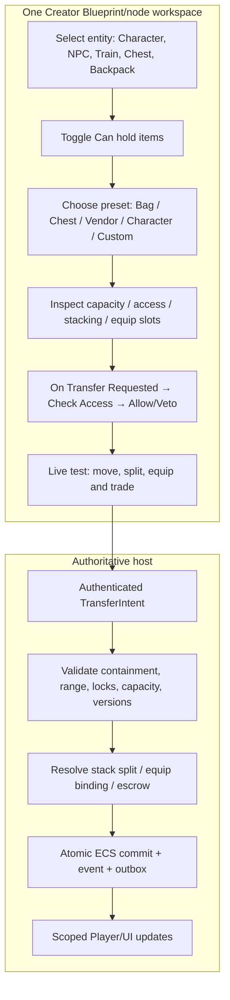
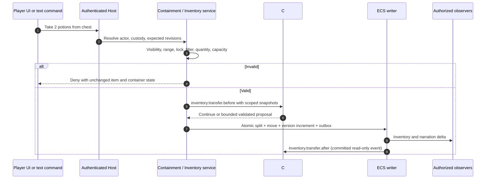

# Technical Case Study 03 — The Traveling Merchant's Chest

**Status:** binding behavior/acceptance example; code is illustrative of the versioned source contract, not a claim of runtime implementation. [Inventory specification](../../03-contracts/inventory-and-containers.md) · [Midnight Express case](07-midnight-express-technical-case-study.md).

## Scenario

Alice stands in Car A of the moving Midnight Express. Her character's default inventory contains a backpack. The backpack contains a sealed medicine pouch and 6 potions (a stack). The train also holds a merchant NPC named Syl and a lockable chest. Syl can possess inventory, and the chest can possess inventory; both are ordinary ECS entities with `ContainerCapability`. Alice may buy a potion, but cannot take objects from the closed chest unless its access policy allows her to open it. Pat, another player, may trade potions with Alice while the train moves. A conductor owns a key; the key remains in the conductor's inventory until explicitly transferred.

The entire example uses **one authoritative containment graph**, even when containers move with the train. No separate backpack database, no special player-only inventory ownership, and no copied entity on equip.

## Creator authoring → runtime → observation



## Sample C# bindings

The following is **C#-style pseudocode** for the source-contract types `InventoryTransferEvent`, `InventoryContainerEvent`, `InventoryEquipmentEvent` and `InventoryMutationEffect`. The `GetPublishedItemTag` / `RequestTransfer` convenience wrappers are illustrative—not registered methods. Native host validation is mandatory before and after hook evaluation.

```csharp
[MudScript("train-chest")]
public sealed class TrainChestHooks
{
    [MudHook("inventory.transfer.before")]
    public HookDecision PreventLockedChestTransfer(HookContext ctx, InventoryTransferEvent e)
    {
        // The event has authorized snapshots only. No direct database access.
        if (e.Source == Assets.TrainChest && ctx.Fields.IsLocked(e.Source))
            return HookDecision.Veto("inventory.container.locked");

        return HookDecision.Continue();
    }

    [MudHook("inventory.item.use.before")]
    public HookDecision DispenseMedicine(HookContext ctx, InventoryTransferEvent e)
    {
        // Item identity / amount are checked again by native custody authority.
        if (!ctx.Fields.HasPublishedTag(e.Item, "medicine"))
            return HookDecision.Continue();

        return HookDecision.Append(
            new InventoryMutationEffect(
                e.Actor, e.Item, e.Source, e.Destination,
                Quantity: 1, ExpectedItemVersion: e.ItemVersion,
                Key: e.EventId + ":medicine-transfer"));
    }

    [MudHook("inventory.equipment.equip.before")]
    public HookDecision PreventTwoHandedConflict(HookContext ctx, InventoryEquipmentEvent e)
    {
        if (e.SlotKey == "main-hand" && ctx.Fields.SecondHandOccupied(e.Holder))
            return HookDecision.Veto("equipment.slot.conflict");

        return HookDecision.Continue();
    }
}
```

A proper compile-ready example must use the approved SDK field-access methods; the snippets above illustrate authoring intent and should not be treated as a passing implementation test. **The actual normative hook IDs, DTO signatures and effect payloads are already in `contracts/scripting/v1`.**

## Item transfer lifecycle



## Acceptance matrix

| Test | Expected result |
|---|---|
| Move backpack from Alice to Syl | Entire nested contents travel under single parent; no duplicate item |
| Chest is locked | Open/take denied without changing custody or quantities |
| Trade 2 of 6 potions | Exactly 4 remain in source, exactly 2 arrive or merge into target |
| Duplicate the same command | No second transfer; same idempotency record |
| Two players race for last potion | Exactly one succeeds |
| Put backpack inside itself | Cycle rejection |
| Put chest inside a pouch inside chest | Transitive cycle rejection |
| Train departs while a transaction begins | Transfer resolves against serialized location/range snapshot, never teleports |
| Equip sword from bag | One equip binding, no second physical owner |
| Drop equipped sword | Unequip and drop commit atomically |
| Close chest midtransfer | Deterministic outcome based on serialized committed order |
| Container with 1,000,000 items | Paginated indexed UI without full-world enumeration |
| Disconnect during escrow trade | Deterministic cancel/expiry/return; no partial exchange |
| Restart during stack split | Persistent onceKey prevents duplicate split and quantity loss |
| Custom C# veto | Native checks still enforced; after-hook cannot reverse a committed transfer |

## In-app milestone

S04.19 shows persisted generic containers in the running shell; S06.16–17 exercises command-based inventory and trades, S08.22 exposes actual Player inventory controls, S09.23–24 lets a nonprogrammer configure arbitrary entity inventory in the Creator, and S13.20 adds C# and graph parity. Each stage requires a demonstrable real world and no fake UI state.
