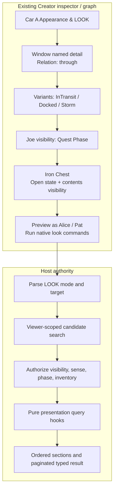
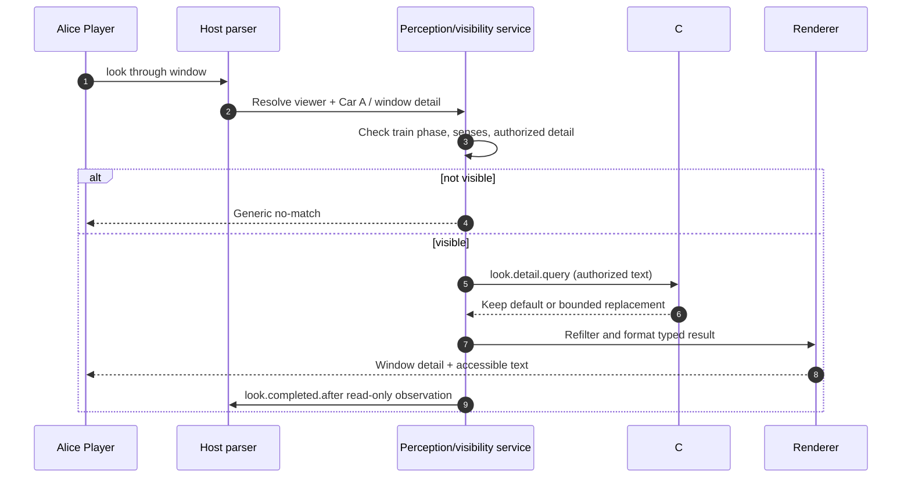

# Technical Case Study 04 — Midnight Express: LOOK at the Train, the Window and Inside a Chest

**Status:** binding scenarios and acceptance behavior; code example uses existing source-level DTOs but does not claim a compiled runtime. [LOOK contract](../../03-contracts/look-and-perception.md), [Midnight Express](07-midnight-express-technical-case-study.md), [Inventory](../../03-contracts/inventory-and-containers.md).

## Scenario

Alice is in **Car A** of the moving Midnight Express. The conductor and a locked iron chest are in Car A. Pat is also aboard, but cannot see Joe, a quest-phased NPC currently inside the carriage. The window has a named **detail**, not a physical object. Looking through it changes description based on the train's current segment and weather. Alice wears an enchanted visor and can perceive a concealed etching; Pat cannot. The carriage is a stable Location even while the parent train moves. The station outside must never be treated as Car A's room until boarding/disembarking is genuinely permitted.

| Command | Alice receives |
|---|---|
| `look` | Car A, current conditioned description, visible conductor/Pat, visible exits and iron chest |
| `l` | Same authoritative projection |
| `look at conductor` | Conductor's appearance, with only permitted details |
| `look window` | Named detail without creating an ECS window entity |
| `look through window` | Conditional passing scenery based on train position; no access to remote hidden entities |
| `look in chest` | Closed/opaque policy response; no inventory disclosure |
| `look at chest` | Exterior name/description, not its contents |
| `look 2.ticket` | Second accessible ticket among deterministically numbered visible matches, or a valid failure |
| `examine chest` | Same exterior by default; extra info only if explicit Examine permission configured |
| `look joe` by Alice | Joe's authorized quest-phase appearance |
| `look joe` by Pat | Generic no-match; not even "hidden NPC present" |

## Native Creator workflow

Open Car A → **Appearance & LOOK**. Supply base description, add a `window` detail and `through` relation, attach world-state variants for InTransit, Approaching or Docked, and set viewer perception conditions. Select chest → **Container** (opaque/locked) and **Appearance**; independently configure the `canLookInside` read grant and `canTake` custody grant. Preview as Alice then Pat, without changing the project state.



## Source-level C# hook example

The **registered** `entity.appearance.desc.query` and `look.detail.query` both use a pure `HookQueryResult`, which can keep default text or replace **already-authorized** presentation text. `LookQueryEvent` has the canonical properties shown below. This is an illustrative *handler* using the defined source types; asset references must be generated from actual published assets at implementation.

```csharp
using MudMaker.Scripting.V1;

[MudScript("midnight-express-look")]
public sealed class TrainLookHooks
{
    [MudHook("look.detail.query")]
    public HookQueryResult WindowDetail(HookContext ctx, LookQueryEvent e)
    {
        if (e.Mode != LookMode.DetailRelation || e.RelationKey != "through")
            return HookQueryResult.Keep();

        // Context is already filtered to permitted world state and allowed detail.
        // The script can restyle the authorized detail; it cannot read hidden scenery.
        return HookQueryResult.ReplaceText(e.AuthorizedText);
    }
}
```

The `HookQueryResult` factory naming above must match the SDK before the example is treated as compile-ready; the hook ID and `LookQueryEvent` DTO are canonical. Graph equivalent: **On Look Detail Query → Is Through? → Get Authorized Default Description → Replace Visible Text**. Neither path receives unfiltered hidden map data.

## Request / response sequence



## Negative and integration tests

1. Pat cannot infer Joe's presence through look, autocomplete, counts, numbered matches, inventory inspection or direct target IDs.
2. Window view changes when train advances, without rewriting Car A's containment parent; external NPC location never leaks.
3. Locked opaque chest has visible exterior but no disclosed items; transparent locked chest may show permitted items and still deny taking.
4. A detail called "window" and an actual visible entity "window" coexist: exact real entity match wins, detail remains accessible via contextual relation.
5. Partial duplicate matches present authorized numbered choices with stable version checks; no hidden candidate slots.
6. A script tries to inject an unauthorized exit/name into a visible description: re-projection rejects untrusted structure and preserves only allowed text.
7. Reconnect and move to Car B invalidates stale Alice Car A target token.
8. Two clients viewing the same physical room have independent quest/weather/sense projections.
9. Screen reader and telnet output match native action semantic sections.
10. Detail/contents queries are paged/bounded and never traverse entire container subtree by accident.
