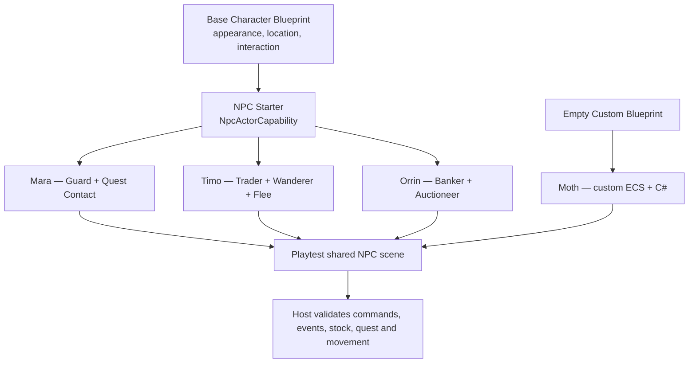
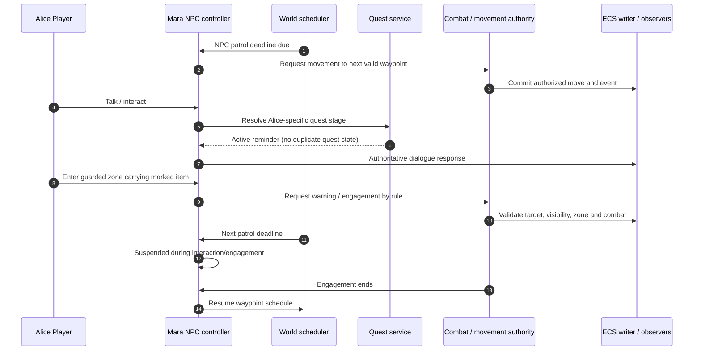

# Technical Case Study 05 — Northgate: guard, quest contact and traveling merchant

**Status:** binding design/test scenario; C# illustration uses source-level contracts and does not claim executable runtime. See [NPC contract](../../03-contracts/npc-templates-and-behaviors.md), [Midnight Express](07-midnight-express-technical-case-study.md), [combat](../../03-contracts/combat-and-encounters.md), [inventory](../../03-contracts/inventory-and-containers.md).

## Scenario

At Northgate station, **Mara** is a patrol guard who also gives the quest `FindJoe`. She walks four authorized waypoints, pauses when a player talks, warns visitors carrying a stolen item, pursues within her leash and returns to the correct patrol waypoint after combat. **Timo** is a traveling merchant: he uses an actual inventory stock, follows a scheduled route to Harbor, pauses trading while moving through a dangerous area and flees instead of attacking. **Orrin** is a banker/auctioneer with a vault/ledger service and auction escrow; his actor itself remains nonattackable in the protected banking hall. **Moth** is a wild creature with completely custom ECS components and C# behavior, no forced humanoid Character type or HP.

Two players, Alice and Pat, share the station. Alice has `FindJoe` active, Pat has not accepted it. Mara's quest dialogue differs, but both see the same *physical* Mara if authorized. NPC movement, quest state, shop transactions and combat operate through their existing services; no NPC holds duplicated authoritative copies.

## Creator composition



**Quick setup:** select a template or Empty Custom, add roles from checkboxes, set obvious fields (waypoints/aggro/quests/stock/services), and click **Playtest NPC**. All advanced configuration is in the same node graph and inspector.

## Host behavior and scheduling



Timo's trade lifecycle is similarly authoritative: resolve purchaser → quote exact visible stock and prices → validate consent/permissions/currency/capacity → atomic transfer and ledger update → publish per-observer events. Orrin's auctions use durable deadlines and escrow with reconnect-safe settlement.

## C# source contract example

The hook identifiers and `NpcLifecycleEvent` / `NpcServiceEvent` classes are registered in the versioned source contract. Code below illustrates **how** a developer could bind and inspect events. It is not a claim that a worker currently executes these hooks.

```csharp
using MudMaker.Scripting.V1;

[MudScript("northgate-npcs")]
public sealed class NorthgateNpcHooks
{
    [MudHook("npc.navigation.route_blocked.after")]
    public HookDecision OnRouteBlocked(HookContext ctx, NpcLifecycleEvent e)
    {
        // Immutable host event; no teleport, direct ECS pointer or database query.
        // The controller's default recovery policy retries with bounded backoff.
        return HookDecision.Continue();
    }

    [MudHook("npc.service.requested.before")]
    public HookDecision BeforeService(HookContext ctx, NpcServiceEvent e)
    {
        // The service authority independently validates the requester,
        // quote, inventory/ledger versions and the actor's current location.
        if (e.Quantity <= 0)
            return HookDecision.Veto("npc.service.invalid_quantity");
        return HookDecision.Continue();
    }

    [MudHook("npc.actor.heard_speech.after")]
    public HookDecision HeardSpeech(HookContext ctx, NpcLifecycleEvent e)
    {
        // Host only delivers authorized speech within applicable hearing scope.
        // Optional LLM can generate an utterance, never gameplay mutations.
        return HookDecision.Continue();
    }
}
```

## Test matrix

| Test | Required result |
|---|---|
| Four waypoint guard patrol | Real path/exits used, no blocked-door bypass; resumes correctly |
| Mara hears conversation | Only in permitted audible scope; stops patrolling per author policy |
| Alice vs Pat quest stages | Different dialogue and objective credit, same persistent Mara |
| Mara becomes aggressive | Rule evaluates authorized perceived character and tagged item |
| Mara assists ally | One aid event, bounded hearing/route and no teleport |
| Mara defeated or frightened | Valid retreat, recovery, leash and configurable defeat |
| Timo shop quote | Visible stock and price, deterministic capacity and currency checks |
| Timo moves during purchase | Atomic outcome or clean denial; no duplicate item |
| Orrin auction survives restart | Exactly one settlement and escrow release |
| Bank account spoof | Denied by authenticated identity, no private account data |
| NPC nonattackable | Host refuses combat intent before creating encounter |
| Two independent NPC role modules | Deterministic priority and cancellation, no duplicated subscriptions |
| NPC runs on empty custom Blueprint | No HP/level/class requirement; C# custom state still works |
| NPC optional AI disabled | Authored dialogue continues with zero model installation |
| 500 idle / 50 active NPCs | Bounded scheduler load; idle NPCs do not each poll the world |
| Creator publishes new NPC revision | Active instances pin or follow defined migration; no silent live mutation |
