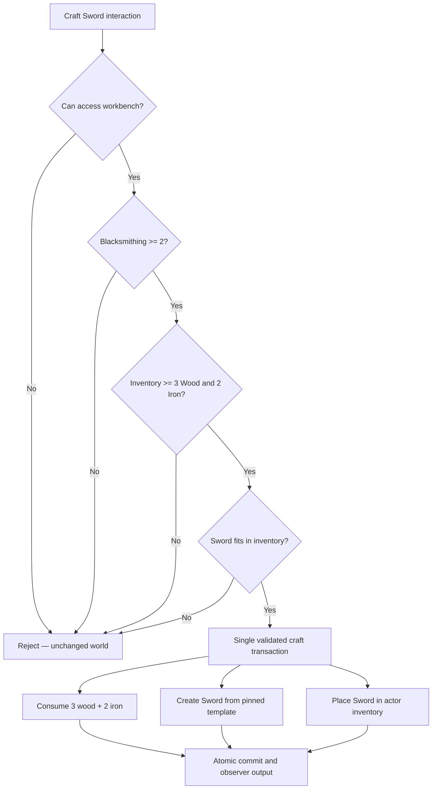

# Creator tutorial — craft a sword with ECS and visual graphs

**Purpose:** build a complete working design using existing [inventory](../../03-contracts/inventory-and-containers.md), [typed ECS fields](../../03-contracts/scripting-v1/04-references-and-state.md), [universal objects](../../03-contracts/ecs-objects-and-exits.md), [templates](../../03-contracts/reusable-templates-and-variants.md) and [graph authoring](../../03-contracts/scripting-v1/06-graph-parity-and-publishing.md). This is a planned tutorial and acceptance oracle; it is not a claim of shipped runtime.

Evennia's [crafting contribution](https://www.evennia.com/docs/2.x/Contribs/Contrib-Crafting.html) treats tagged ingredients and reusable tools as separate categories and creates outputs from prototypes, with validation/craft/post-craft hooks. MudMaker retains the recipe semantics through typed reusable assets and transactional ECS effects.

## Scenario

The player stands at a **Workbench** (ordinary ECS entity with `InteractableCapability`). Their inventory contains at least **3 Wood** and **2 Iron**; Character has `Skills.blacksmithing >= 2`. When player uses **Craft Sword** on the workbench: validate character and station accessibility, count qualifying materials in player's permitted inventory, check skill, consume exactly three Wood and two Iron, instantiate one published Sword template, and place it into the player's own inventory. Any failure leaves materials untouched and produces a clear error. Capacity is checked *before* removing inputs; default policy rejects craft on insufficient capacity (no ground-spawn overflow). No default durability loss, failure RNG or craft time.

## Authoring walk-through

1. Create `Wood` and `Iron` item templates, mark stackable, assign `crafting.material.wood` / `crafting.material.iron` typed tags, and test inventory quantities. Make `Sword` item template (quantity 1).
2. On the Character template add a typed integer `Skills.blacksmithing` field, min 0, default 0. Test actor has value 2.
3. Create Workbench entity from Empty Custom: Appearance + Interactable; no NPC subclass, no special CraftingStation root type.
4. In the Workbench Blueprint graph create **On Interact: craft-sword**. Bind command `craft sword` / `use workbench` to the same typed interaction. This is a saved reusable graph asset.
5. Add graph nodes in order: **Resolve Authorized Actor → Check Workbench Reach/Use Access → Read Field (Skills.blacksmithing) → Compare >= 2 → Query Inventory by Published Tag (Wood) → Sum Quantity >= 3 → Query Inventory by Published Tag (Iron) → Sum Quantity >= 2 → Preview Output Capacity → Request Craft Transaction**.
6. Craft Transaction inputs: actor, workbench, `SwordTemplateId + pinned Revision`, requirements `[wood:3,iron:2]`, expected inventory item/container versions, target actor inventory, onceKey `world+actor+recipe+requestId`. The host resolves exact matching stacks and enforces **atomic consume+instantiate+place** in one ECS writer transaction.
7. **On Craft Committed** graph displays success to actor and authorized local observers, optionally awards a quest objective via separate idempotent credit. **On Craft Rejected** displays typed reason (not enough wood, not enough iron, skill too low, inaccessible station, inventory full, stale materials).
8. Save Workbench as a universal project template, create an alternate **Master Workbench** variation requiring blacksmithing >= 5, test both in real Creator → Play preview. A creator may replace the graph with approved C# hooks and the same effect capability; never direct ECS mutations.

## Graph/SDK capabilities required

Canonical commands/nodes: `Inventory.QueryByTag`, `Inventory.SumQuantity`, `Character.ReadTypedField`, `CompareInteger`, `Interaction.CheckReachAccess`, `Inventory.PreviewCapacity`, `Craft.RequestTransaction`, `Craft.OnCommitted`, `Craft.OnRejected`, `Template.ResolvePublishedRevision`, `Narration.EmitAuthorized`. Runtime `CraftRequestEvent` and `CraftTransactionEffect` must be source-registered and implemented across JSON/CLR/Proto/graph before this test is marked passing. `CraftTransactionEffect` contains actor, station, requirement-tag/quantity entries, output TemplateRef, destination, expected versions and onceKey. The authoritative native writer rejects stale/unauthorized fields and deduplicates output instantiation.

No hypothetical sequence of independent `RemoveItem` and `AddItem` actions qualifies: crafting must be atomic, else a crash or full inventory duplicates/destroys resources. The graph expresses predicates and invokes one transaction effect; C# authors use the identical effect DTO.

## Tests

Success at exactly 3 Wood/2 Iron and skill 2; failure at skill 1, 2 Wood, 1 Iron, locked station, full inventory, hidden or remote station; mix two valid wood stacks; unrelated iron tags excluded; parallel players craft from private inventories; duplicate request commits one sword; concurrent inventory GET race rejects stale craft without consuming resources; process crash before/after commit recovers exactly once; Sword instance uses pinned template revision; positive and negative paths visible through keyboard, text and graph preview.
